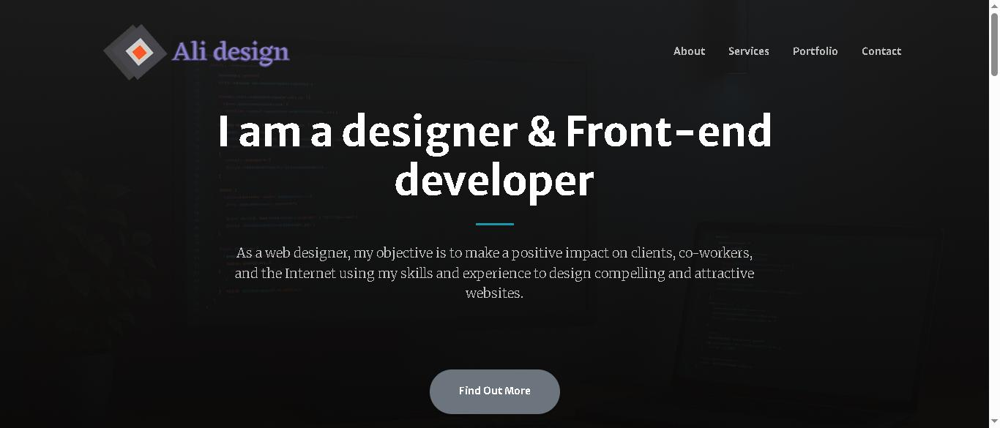
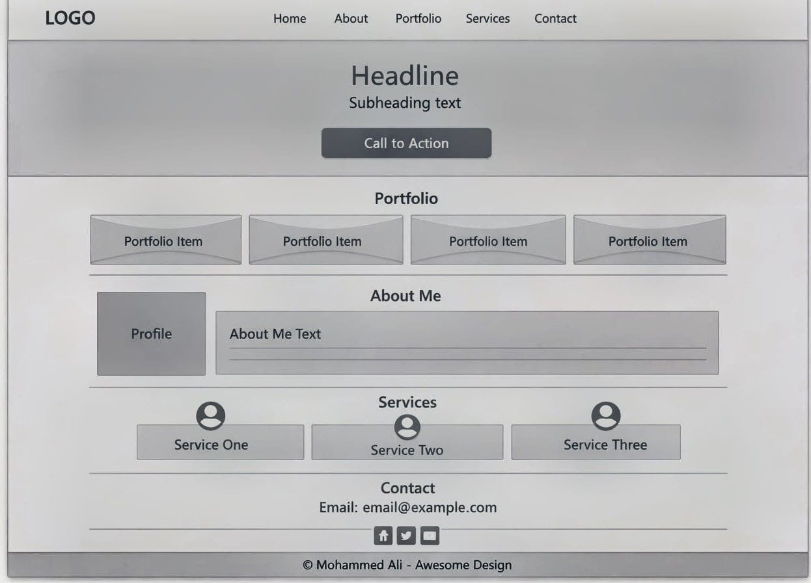
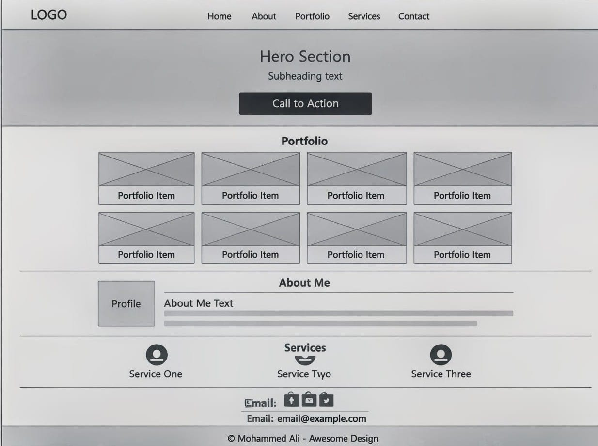
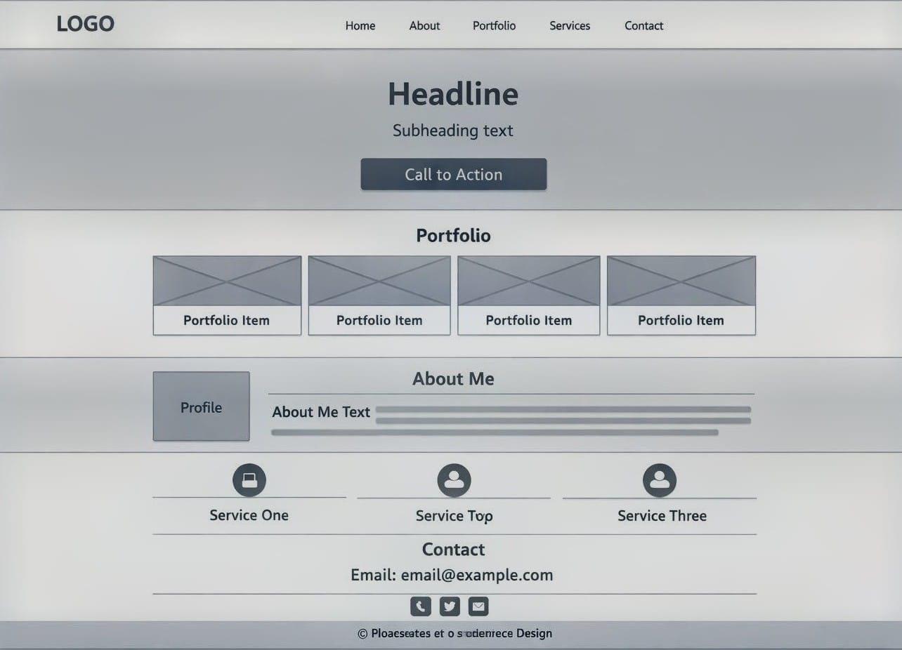
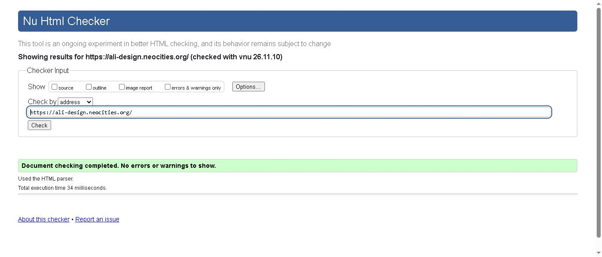
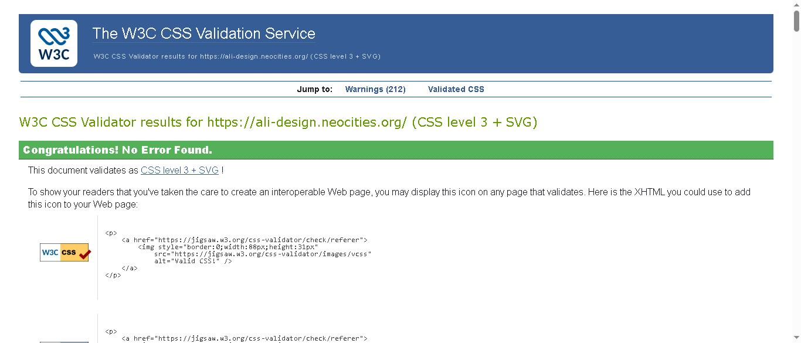
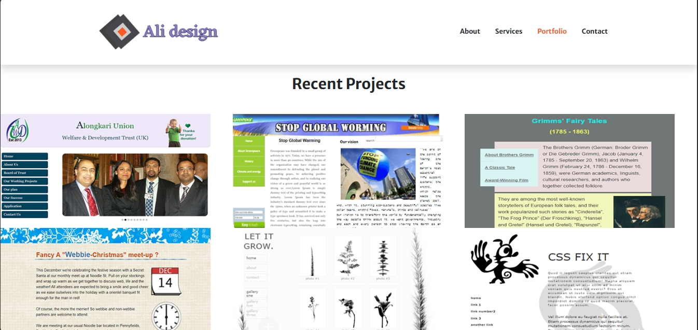
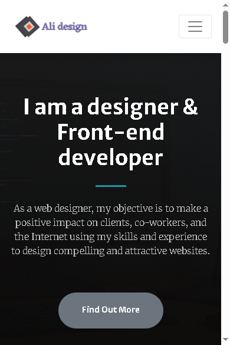
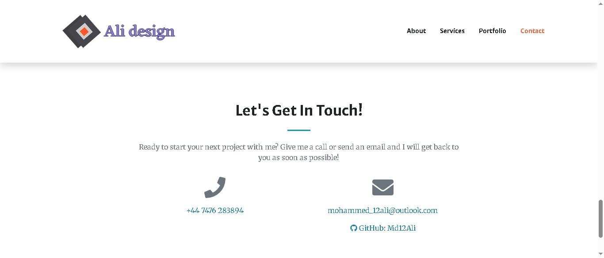

# Awesome Design — Portfolio Website

**Live site:** [https://ali-design.neocities.org/](https://ali-design.neocities.org/)  
**Repository:** [https://github.com/Md12Ali/Awesome-Design](https://github.com/Md12Ali/Awesome-Design)  
**Author:** Mohammed Ali  
**Unit:** Unit 1 – User Centric Front End Development (Y/650/3525)

## Contents
1. [Project Overview](#1-project-overview)
2. [UX Design](#2-ux-design)
3. [Features](#3-features)
4. [Technologies Used](#4-technologies-used)
5. [Credits and Attribution](#5-credits-and-attribution)
6. [Testing](#6-testing)
7. [Bugs](#7-bugs)
8. [Deployment](#8-deployment)
9. [Development Log](#9-development-log)

---

## 1. Project Overview
Awesome Design is a single-page portfolio website that presents my work as a designer and front-end developer.

**Who it is for:** potential clients looking for a web or graphic designer, and employers looking at my skills and previous projects.

The page has five sections, reached from a fixed navigation bar with smooth scrolling: **Hero, About, Services, Portfolio and Contact**.

**How it was built:** the site is built by customising two free Start Bootstrap templates, **Creative** and **Stylish Portfolio**. It is not written from scratch. [Section 5](#5-credits-and-attribution) lists exactly which code comes from the templates and which is my own work.

## 2. UX Design

### User stories and acceptance criteria
| # | User story | Acceptance criteria |
|---|------------|---------------------|
| 1 | As a **new visitor**, I want to understand what the site is about straight away, so I can decide whether to stay. | The first screen shows a headline saying who I am and what I do. There is a button leading to the rest of the page. The menu is visible. |
| 2 | As an **employer**, I want to see real projects I have built, so I can judge my skills. | A Portfolio section shows at least six real projects, each with a name and category. Clicking a project opens a larger image. |
| 3 | As a **mobile user**, I want the site to work on my phone, so I can browse it anywhere. | On screens narrower than 992px the menu collapses into a menu button. Sections stack in one column. There is no horizontal scrolling. |
| 4 | As a **potential client**, I want an easy way to contact Mohammed, so I can discuss a project. | The Contact section shows a phone number and an email address. Both are clickable links that open the dialler or email app. |
| 5 | As a **screen-reader user**, I want images and page areas described, so I can understand the content. | Every content image has descriptive alt text. The navigation is labelled. Decorative icons are hidden from screen readers. |

The [Testing section](#user-story-verification) verifies each story against the live site, with screenshots.

### Design principles
- **Simplicity:** clean sections, clear headings and only four menu links.
- **Information hierarchy:** introduction first (Hero, About), proof of work second (Services, Portfolio) and contact last.
- **Consistency:** one teal brand colour (`#0f6674`) on dividers and section backgrounds, the same grey button style, and the same fonts and icon style throughout.
- **User control:** nothing plays or moves on its own. Every action (menu, scrolling, opening a project) is started by the user.
- **Mobile first:** the Bootstrap grid stacks content on small screens and spreads it out on larger ones.

### Typography
- **Merriweather Sans** for headings and navigation. This comes from the Creative template.
- **Merriweather** for body text. I set this in `custom.css`.
- Both fonts are loaded from Google Fonts.

### Wireframes
I made low-fidelity wireframes in Adobe Photoshop before building the site, to plan the layout on desktop, tablet and mobile.

**Changes from wireframe to final site:**
- The final site has four services instead of three, and six portfolio projects.
- The About section is text only, with no profile image.
- The menu follows the order of the sections on the page: About, Services, Portfolio, Contact.

## 3. Features

### Existing features
- **Navigation:** fixed navigation bar with my logo. It collapses into a menu button on small screens and scrolls smoothly to each section.
- **Hero:** headline ("I am a designer & Front-end developer"), short introduction and a "Find Out More" button.
- **About:** introduction to me and the tools I use, with a "Get Started!" button.
- **Services:** four services with icons: Responsive Design, Coding, Logo Design and Graphic Design.
- **Portfolio:** six of my projects (Welfare Trust, Greenpeace, Fairy Tales, Meet-Up, Let It Grow and CSS Fix It). Each has a hover caption and opens in a lightbox.
- **Contact:** clickable phone number (`tel:`), email link (`mailto:`) and a link to my GitHub profile.
- **Footer:** copyright line with the template credit.

### Accessibility
- **Semantic elements:** `<nav>`, `<header>`, `<main>`, `<section>` and `<footer>`.
- **Heading structure:** one `<h1>` (hero), an `<h2>` for each section (About, Services, Recent Projects, Contact) and an `<h3>` for each of the four services.
- **Colour contrast:** checked against WCAG 2.1 AA (4.5:1 for normal text, 3:1 for large text) with the WebAIM Contrast Checker formula.

  | Where | Text colour | Background | Ratio | Result |
  |-------|-------------|------------|-------|--------|
  | About and Services body text (before fix) | `#dadada` / 70% white | `#1997ab` | about 2.5:1 | Fail |
  | About and Services body text (after fix) | `#ffffff` | `#0f6674` | 6.62:1 | Pass |
  | About and Services headings | `#ffffff` | `#0f6674` | 6.62:1 | Pass |
  | Buttons | `#ffffff` | `#6c757d` | 4.69:1 | Pass |
  | Contact text | `#6c757d` | `#ffffff` | 4.69:1 | Pass |
  | Footer text (after fix) | `#5a6268` | `#f8f9fa` | 5.89:1 | Pass |
- **Alt text:** every content image has descriptive alt text, including the logo and all six portfolio images:

  | Image file | Alt text |
  |------------|----------|
  | `logo.png` | Mohammed Ali Design Portfolio Logo |
  | `welfare-trust.png` | AU Welfare Trust charity website user interface mockup |
  | `greenpeace.png` | Greenpeace global warming responsive campaign website |
  | `fairy-tales.png` | Grimm Fairy Tales interactive web presentation |
  | `meetup.png` | Meet-Up event registration website |
  | `grow.png` | Let It Grow agricultural business website |
  | `css-fix.png` | CSS Fix It responsive layout project |

- **ARIA:**
  - The navigation has `aria-label="Main navigation"`.
  - The menu button has `aria-label="Toggle navigation"`.
  - Decorative icons have `aria-hidden="true"`.
- **Links:**
  - The email link uses `mailto:` and the phone number uses `tel:`.
  - External links, the email link and the portfolio images open in a new tab with `target="_blank" rel="noopener noreferrer"`.
- **Meta description:** included for search engines and link previews.

### Future features
- Contact form with validation
- Separate case-study pages for each portfolio project
- Dark mode

## 4. Technologies Used
| Technology | Version | Used for |
|------------|---------|----------|
| HTML5 | | Page structure and semantic markup |
| CSS3 | | Template styles plus my own styles in `css/custom.css` |
| Bootstrap | 4.5.3 | Grid, navbar and responsive utilities. The CSS is compiled into the Creative template's `styles.css`; the JavaScript bundle loads from a CDN. |
| Google Fonts | | Merriweather and Merriweather Sans |
| Font Awesome | 5.15.1 | Service, contact and GitHub icons |
| jQuery | 3.5.1 (full build) | Required by Bootstrap and the template script. The full build is needed because the slim build has no `.animate()` for smooth scrolling. |
| jQuery Easing | 1.4.1 | Smooth scrolling |
| Magnific Popup | 1.1.0 | Portfolio image lightbox |
| Adobe Photoshop and Illustrator | | Wireframes, logo and graphics |
| Git and GitHub | | Version control |
| Neocities | | Hosting |

## 5. Credits and Attribution

### Templates used
This project was built by customising two Start Bootstrap templates. Both are released under the MIT License.

| Template | Files from the template | What it provides |
|----------|-------------------------|------------------|
| [Start Bootstrap – Creative v6.0.4](https://startbootstrap.com/theme/creative) | `css/styles.css`, `js/scripts.js`, base layout of `index.html` | Bootstrap 4.5.3 CSS, navigation bar, hero (masthead), About, Portfolio and Contact layouts, smooth scrolling and lightbox script |
| [Start Bootstrap – Stylish Portfolio v5.0.9](https://startbootstrap.com/theme/stylish-portfolio) | `css/stylish-portfolio.css` | Services section layout and round service icons |

My colour changes are no longer inside the template files. I have trimmed some unused rules from `stylish-portfolio.css`, but otherwise the template CSS and JavaScript are as downloaded. All of my own CSS is in a separate file, `css/custom.css`, which loads after the template files and overrides them. In `index.html`, the sections I customised are marked with `<!-- ... (customised: ...) -->` comments.

### What I customised (my own work)
- **Content:** all text (headline, introduction, About bio, the four service descriptions and contact details).
- **Portfolio:** my own six project screenshots, with project names, categories and alt text.
- **Logo:** designed in Adobe Illustrator and added to the navigation bar. I also made the favicon.
- **Combining the templates:** the Creative template's page structure is combined with the Stylish Portfolio services section.
- **Services:** four services with my own choice of Font Awesome icons.
- **Contact:** working `tel:`, `mailto:` and GitHub links.
- **`css/custom.css`** (all my own CSS):
  - Teal brand colour (`#0f6674`, darkened from `#1997ab` for contrast) replacing the Creative template's orange on dividers and section backgrounds
  - Grey buttons (`#6c757d`) replacing the Stylish Portfolio blue
  - Media query that shrinks the logo on screens below 992px, so the mobile navbar does not cover the headline
  - White text on the teal sections and a darker footer text colour to pass WCAG AA contrast
  - Font sizes for the new Services H2 and H3 headings
  - Merriweather body font
  - Corrected path for the hero background image
  - Portfolio image scaling and hover zoom
  - Button hover lift effect
- **Accessibility:**
  - Alt text on every image
  - ARIA labels, and decorative icons hidden from screen readers
  - A `<main>` landmark
  - Meta description
- **Files:** renamed all images and the `portfolio/` folder to lowercase, descriptive names.
- **Documentation:** wireframes, testing and this README.

### External resources
- Bootstrap 4.5.3 (included in `styles.css`)
- Google Fonts: Merriweather and Merriweather Sans
- Font Awesome 5.15.1
- jQuery 3.5.1 and jQuery Easing 1.4.1
- Magnific Popup 1.1.0 (image lightbox)

### Tools and AI assistance
- **Gemini and Microsoft Copilot:** research and help writing documentation.
- **Claude (Anthropic):** helped consolidate this README into one document and apply the assessor's fixes:
  - Moving my colour changes out of the template files into `custom.css`
  - The mobile navbar fix
  - ARIA attributes and the `<main>` landmark
  - The link fixes
  - The hero background path

  I reviewed every change.
- **Adobe Photoshop and Illustrator:** wireframes, logo and graphics.

### Acknowledgements
Thanks to my assessor, Yassin Hassan, for clear feedback that helped me improve the accessibility, documentation and accuracy of this project.

## 6. Testing

### Code validation
**HTML:** W3C Nu HTML Checker, tested on the live site. Result: no errors or warnings.

**CSS:** W3C Jigsaw CSS Validator (CSS level 3 + SVG), tested on the live site. Result: no errors.

### User story verification
| # | User story | How it is met | Evidence | Result |
|---|------------|---------------|----------|--------|
| 1 | New visitor understands the site | The hero headline "I am a designer & Front-end developer" and the menu are visible on the first screen. | Screenshot 1 | Pass |
| 2 | Employer sees real projects | Six projects shown in the Portfolio grid. Clicking one opens it in the lightbox. | Screenshot 2 | Pass |
| 3 | Site works on mobile | Below 992px the menu collapses and sections stack in one column, with no horizontal scrolling. | Screenshot 3 | Pass |
| 4 | Client can make contact | Phone (`tel:`) and email (`mailto:`) links in the Contact section open the dialler and email app. | Screenshot 4 | Pass |
| 5 | Screen-reader user understands content | All images have alt text. The navigation is labelled and icons are hidden. The HTML validator passes. | Alt text table in [section 3](#accessibility), HTML validation above | Pass |

**Screenshot 1:** hero section on desktop  

**Screenshot 2:** portfolio grid with six projects  

**Screenshot 3:** site on a mobile screen  

**Screenshot 4:** contact section  

### Manual testing (after the 11 November 2026 fixes)
Tested on the live site after redeploying to Neocities. **Actual** is what happened when I ran the test.

**Browsers:** Chrome, Firefox, Edge, Safari (iPhone)
**Screen sizes:** 320px, 375px (phone), 768px (tablet), 1366px (laptop), 1920px (desktop)

| Area | Test | Browser / screen size | Expected result | Actual result | Pass/Fail |
|------|------|-----------------------|-----------------|---------------|-----------|
| Console | Open DevTools > Console, load the page, then use every link and button | Chrome 1366px | No errors in the console | TBC | TBC |
| Navigation | Click About, Services, Portfolio and Contact | Chrome, Firefox, Edge 1366px | Page scrolls smoothly to that section, no console errors | TBC | TBC |
| Logo | Click the logo | Chrome 1366px | Page scrolls back to the top | TBC | TBC |
| Hero button | Click "Find Out More" | Chrome 1366px | Scrolls smoothly to About | TBC | TBC |
| About button | Click "Get Started!" | Chrome 1366px | Scrolls smoothly to Services | TBC | TBC |
| Mobile menu | Tap the menu button, then tap a link | Chrome 375px, Safari iPhone | Menu opens; after tapping a link it closes and scrolls to the section | TBC | TBC |
| Gallery | Click each of the six projects, use the arrows, press Esc | Chrome, Firefox 1366px | Image opens in the lightbox, arrows move between images, Esc closes it | TBC | TBC |
| Portfolio hover | Hover over a project | Chrome 1366px | Image zooms | TBC | TBC |
| Contrast | Check About and Services text | Chrome 1366px | White text on dark teal, easy to read (6.62:1) | TBC | TBC |
| Email link | Click the email address | Chrome 1366px | Email app opens with the address filled in | TBC | TBC |
| Phone link | Tap the phone number | Safari iPhone | Dialler opens with the number | TBC | TBC |
| GitHub link | Click "GitHub: Md12Ali" | Chrome 1366px | github.com/Md12Ali opens in a new tab | TBC | TBC |
| Images | Load the page | All browsers | All images and the hero background display | TBC | TBC |
| Responsive | Resize through 320, 375, 768, 1366, 1920px | Chrome DevTools | Layout adapts, no horizontal scrolling | TBC | TBC |
| Keyboard | Use only Tab and Enter | Chrome 1366px | Every link and button can be reached and used | TBC | TBC |

## 7. Bugs
Every bug below was retested on the live site after the fix.

| Bug | Cause | Fix | Retested | Status |
|-----|-------|-----|----------|--------|
| Console error "animate is not a function" when clicking nav links and buttons; smooth scrolling broken | The slim jQuery build has no `.animate()` | Switched to the full jQuery 3.5.1 build | TBC | Fixed |
| About and Services text hard to read (about 2.5:1 contrast) | Light grey / 70% white text on `#1997ab` | Darker teal `#0f6674` and white text (6.62:1) | TBC | Fixed |
| Services headings skipped from H3 to H4 with no H2 | Template heading levels | H2 for the section, H3 for each service | TBC | Fixed |
| `Portfolio/` folder had a capital letter | Original folder name | Renamed to `portfolio/` and updated README paths | TBC | Fixed |
| Navbar covered the top of the hero headline on phones | The full-size logo pushed the menu button onto a second line, making the fixed navbar too tall | Media query in `custom.css` that shrinks the logo below 992px | TBC | Fixed |
| External links opened in the same tab | Links were missing `target="_blank"` | Added `target="_blank" rel="noopener noreferrer"` | TBC | Fixed |
| Email link gave an error instead of opening the email app | `href` was missing the `mailto:` prefix | Added `mailto:` | TBC | Fixed |
| Portfolio images had empty alt text | Template placeholders not filled in | Wrote descriptive alt text for all six images and the logo | TBC | Fixed |
| Image filenames had capitals (e.g. `Capture1.PNG`) | Default screenshot names | Renamed to lowercase, descriptive names and updated `index.html` | TBC | Fixed |
| Hero background image did not load | Template path pointed to a missing `assets/img/` folder | Overrode the path to `img/bg-masthead.jpg` in `custom.css` | TBC | Fixed |

## 8. Deployment
The site is hosted on **Neocities**, a free static hosting service.

1. Validated the HTML and CSS, and tested all links and file paths locally.
2. Logged in to the Neocities dashboard.
3. Uploaded the contents of the `portfolio/` folder (`index.html` and the `css/`, `js/` and `img/` folders) to the root of the site, keeping the same structure as the repository.
4. Opened the live site and checked that all images, navigation, links and the lightbox work, with no errors in the browser console.

To update the site, I commit the changes to GitHub first. Then I upload the same changed files to Neocities and check the live page again.

### Run locally
1. Clone the repository: `git clone https://github.com/Md12Ali/Awesome-Design.git`
2. Open `portfolio/index.html` in any browser. Nothing needs to be installed.

---

## 9. Development Log
Earlier commits made through the GitHub web uploader have generic messages ("Add files via upload", "Update README.md"). [DEVELOPMENT_LOG.md](DEVELOPMENT_LOG.md) explains what each stage of work actually changed.

---

**Contact:** Mohammed Ali — [mohammed_12ali@outlook.com](mailto:mohammed_12ali@outlook.com)
